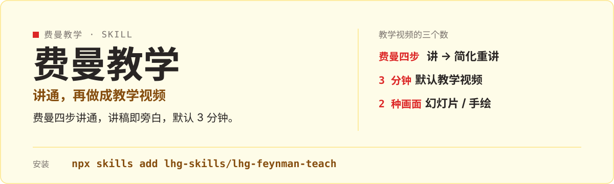

<p align="center">
  
</p>

# lhg-feynman-teach · 费曼教学

把一个知识点用费曼法讲通，再做成讲稿即旁白的教学视频（默认 3 分钟，幻灯片 / 手绘两种画面）。

（SKILL.md v1.3.0）

## 它是什么

- 费曼四步讲通：讲 → 找卡点 → 回源补漏 → 简化重讲，含模拟观众追问。
- 输出学习结论 + 讲稿即旁白的教学视频（默认 3 分钟）。
- 两种视觉模式：幻灯片 / 手绘。
- references 含 beat-sync、handdraw-mode、video-spec 等 7 个实操文档；手绘模式依赖 vendor/，安装时保留 vendor/。

## 先试一句

| 你说 | 它给你 |
|---|---|
| 用费曼法讲讲 X | 讲 → 找卡点 → 回源补漏 → 简化重讲，含模拟观众追问 |
| 把 X 做成教学视频 | 学习结论 + 讲稿即旁白的视频，默认 3 分钟 |
| 给小白讲明白 X | 简化重讲，讲给外行听懂为止 |

## 安装

```bash
npx skills add lhg-skills/lhg-feynman-teach
```

安装后把整个目录放进 skills 目录时**保留 `vendor/`**，手绘模式依赖它。

<details>
<summary>发给 Agent 的安装话术（推荐：小白用户直接复制整段发给你的 Agent）</summary>

> 请帮我安装 Skill「lhg-feynman-teach」：先从 Gitee 上 lhg-skills 组织下的 lhg-feynman-teach 仓库下载；如果 Gitee 无法访问或下载失败，改从 GitHub 上 lhg-skills 组织下的同名仓库下载。按当前 Agent 的规范安装其中的 Skill，优先全局安装，保留完整目录和依赖。请直接执行，完成后验证是否安装成功，告诉我实际使用的来源、安装的版本号以及如何调用；遇到访问或安装限制请说明具体原因。需要输入管理员密码或确认风险时停下来等我。

**怎么算装好了**：Agent 能在已安装的 Skill 里看到 `lhg-feynman-teach`，并报出版本号（与仓库 `SKILL.md` 的 `version` 一致）。只是打开了仓库网页不算安装。

</details>


## 它怎么做

1. 输入想讲的主题
2. 费曼四步讲通
3. 模拟观众追问
4. 学习结论
5. 选视觉模式（幻灯片 / 手绘）
6. 输出讲稿即旁白的教学视频

## 什么时候用 / 不用

**用它，当你：**

- 把概念讲给别人听、做知识短视频
- 想验证自己是不是真讲通了
- 要讲稿和视频一次给齐

**别用它，当你：**

- 只要文字讲稿不要视频——它默认交付视频
- 手绘模式缺 vendor/ 跑不了——安装时保留 vendor/
- 指望它替你选主题——输入主题来自你

## 目录结构

```
SKILL.md            skill 全文
references/         7 个实操文档
  beat-sync.md / feynman-checklist.md / handdraw-mode.md
  learning-methods.md / smoke-test.md / upstream-tracking.md
  video-spec.md
examples/
  ai-learn-30s/     完整示例
vendor/             手绘模式依赖，安装时保留
LICENSE             MIT
manifest.yaml
icon-512.png
```

## 自检与反馈

在仓库根目录运行 `bash examples/ai-learn-30s/run.sh`（字体环境变量见 `examples/ai-learn-30s/README.md`）；手绘模式另跑 `python3 vendor/sweety-handdraw-video/skills/sweety-handdraw-video/scripts/smoke_test.py --output <新建空目录>`。

发现问题请提 issue：[提一个 issue](https://github.com/lhg-skills/lhg-feynman-teach/issues/new)（标题以 `[QC] ` 开头，写清你让它做了什么、它实际给了什么）。

---

## 出品：刘洪光

本 skill 由真人出镜 IP「刘洪光」（安徽合肥）出品，归属 [lhg-skills](https://github.com/lhg-skills)。

- GitHub 主页：https://github.com/lhg-skills —— 全部 skill 开源在此，欢迎 star
- 抖音：搜「刘老师讲AI实战」
- 微信：lhgsmsw

觉得有用，欢迎点 ⭐ Star。
